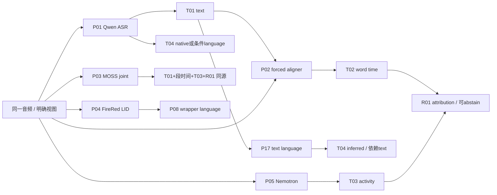

# Producer → tag 能力与实际发布边界

日期：2026-10-20。`Pxx`=producer，`Cxx`=具体能力claim，`Txx/Rxx/Dxx`见[tag registry](tag_registry.md)，`Qxx`见[task coverage](task_coverage.md)。S-*来源可在[survey ledger](model_survey.md)定位官方URL、固定commit/unknown、许可证和缓存；LA-*见[本地审计](local_audit.md)。完整公开字段映射及gender/C50冲突见[schema_mapping](schema_mapping.md)。

## 1. 判断维度

能力来源分 `native`（生产者直接输出，包括内部输出被适配器暴露）、`deterministic_derived`（确定性投影/规则）、`inferred`（文本推断/解释）、`candidate`（尚未实现路径）。一次pipeline有多个来源，不因外层API统一就变成一个checkpoint的native能力。

来源支持与验证分开：`documented / code_supported / hypothesized / unsupported / unknown`；本地状态为 `observed / reproduced_static / not_run / planned`。`observed`只指链接的历史运行有此输出，不能等价为通过准确率测试。所有未校准分数不视为正确概率，所有未实测成本标unknown。

## 2. 核心producer与逐claim记录

| claim / producer | tag、路径、输入→输出语义 | 条件、依赖与confidence | 来源支持 / 本地验证 / 成本边界 |
| --- | --- | --- | --- |
| C01 / P01 Qwen3-ASR-0.6B（1.7B仅上游候选） | T01 native：audio + optional text context → text；T04 native language when language=None | 官方30语言+22中文方言；language参数强制prompt前缀，不是无条件LID；context是文本非speaker mask；text规范化/标点/口吃保存无完整独立保证 | S-Qwen wrapper `transcribe/_build_text_prompt` code_supported；0.6B V03 observed、1.7B not_run；质量/延迟不从0.6B外推1.7B |
| C02 / P01强制语言路径 | T04输入条件回显/解析；非新的音频语言观察 | wrapper `parse_asr_output(..., user_language=forced_lang)`；无需假定返回English就证明听到了English。shared Plus调用language=None；gateway可传language/context，二者不同 | S-Qwen + LA-05 code_supported；反事实提示准确率V12 planned |
| C03 / P02 Qwen3-ForcedAligner-0.6B | T02 native alignment，audio+T01 text+language→词/字边界；由wrapper加chunk offset | 11语言、单次约≤5min；非识别/纠错/身份；argmax时间类经后处理输出，可有零时长；返回对象无已校准边界正确概率 | S-Qwen aligner code_supported；V03 observed；local词边界准确率planned；与P01一起调用成本应计两模型 |
| C04 / P01+P02 offline/streaming | offline wrapper可T01/T04/T02；streaming vLLM路径T01/T04，所读版本不返回timestamps | wrapper自动切窗，offset应只加一次；时间戳并非ASR decoder原生；ASR语言覆盖不能套到aligner | S-Qwen README/代码；LA-05 + V03；当前302条最长94.5225s，未验证长窗融合 |
| C05 / P03 MOSS-Transcribe-Diarize0.9B | T01+段级T02+R01 joint native：`[start][Sxx]text[end]`→parsed segments；T03为这些段的活动投影 | 上游50+语言，本地card宣称≤90min；16k/30s encoder chunks不等于整段只支持30s；无显式声纹/mask输入或独立帧活动概率输出；speaker仅匿名；默认prompt和event prompt分开 | S-MOSS README/input/parser code_supported；AMI整链V01、smoke V03 observed；非言语onset准确度unknown；Pro结果不转移0.9B |
| C06 / P04 FireRedLID | T04 audio native → 样本lang/confidence | 上游100+语言+20+方言；language code混语语义单独核对；样本`sn,.512`并非已校准置信 | S-FireRed documented；V03 observed；LA-03具体checkpoint hash；英文smoke错语言是单例边界证据，非全局accuracy |
| C07 / P08 FireRedASR2-AED | T01 native；T02为内部CTC forced align→适配暴露，失败可uniform token interpolation | ASR中英/方言/code-switch；语义AED=attention encoder-decoder，**不是audio event detection**；普通词时间与fallback须分别标源；标点模块是另一producer | S-FireRed documented；LA-02 code/log observed：smoke bfloat16失败后插值；Plus use_half=false不能套用同一故障推断 |
| C08 / P08 wrapper附language | T04来自额外P04调用，wrapper assembly为deterministic projection | `_attach_language_observation`；与standalone P04相同checkpoint，language失败不应毁掉独立text | LA-03 code_supported/observed；不计独立LID证人；额外加载/推理成本实际存在 |
| C09 / P05 Nemotron-3-Diarization | T03：16k mono→[T,8]活动概率→阈值区间；最多8人、arrival-order匿名ID | 模型卡100M、可配10ms倍数输出、chunked长音频；stream buffer latency不等于本机end-to-end latency；不产文字；probabilities校准unknown | S-Nemotron本地card documented；smoke P05 observed（RTX4090、torch2.8），run checkpoint固定；不能将所有buffer配置视为已测 |
| C10 / P06 DiariZen v2+WeSpeaker/PLDA | T03 native pipeline→overlap可并存的区间/RTTM | code与checkpoint、embedding版本分开；无文字；不是与pyannote完全无关；num_speakers等约束不是自然语言ICL | S-DiariZen documented + LA/V03 observed；本地torch2.1.1+cu121；独立性unknown；权重CC-BY-NC |
| C11 / P07 WhisperX | T01 ASR→T02语言aligner→T03 pyannote→R01 overlap assignment | 多模型pipeline；字典外数字等可缺时间；README明确overlap弱；`assign_word_speakers`选最大交集，fill_nearest可无交集赋人，与Plus拒答规则不同 | S-WhisperX README/alignment/diarize code_supported；本轮not_run；不同pipeline输出不能直接认为同归属合同 |
| C12 / P09 FireRed VAD/Stream-VAD/AED | T05 native speech intervals；AED T06/T07为speech/singing/music三类区间 | VAD non-speech不是静音；AED ratio=原始过阈值帧占比，public另有ratio floor；三类不覆盖咳嗽等细粒度 | S-FireVAD documented；LA-07 code_supported；VAD/stream VAD smoke observed，AED能力质量not_run |
| C13 / P10 DASS medium AudioSet48.9 | T06 clip/window 527类sigmoid→跨窗max→公共noise/composition投影 | 本地16k mono分窗/末窗补零；无输出强事件时间；ToolResult.confidence固定1.0，不能当已校准置信；AST/HTS-AT蒸馏依赖 | S-DASS + LA-07 code_supported；资产/adapter存在，smoke inventory未healthcheck；质量/成本unknown |
| C14 / P11 PANNs；P25 BEATs | T06类别分数/T17 audio representation；PANNs决策级模型另有T07 frame-wise SED候选 | PANNs README另列Cnn14_DecisionLevelMax/Avg/Att帧级SED与checkpoint；2s连续片段demo是另一条路径，均需阈值/后处理形成事件；BEATs audio-only representation与AudioSet分类头/CLAP共同空间不同；speaker attribution不支持 | S-PANNs、S-Supp/BEATs documented；PANNs本地asset/adapter，BEATs新增not_run；权重精确license/revision unknown |
| C15 / P12 DNSMOS | T08：无参考speech quality预测SIG/BAK/OVRL/P808；非SNR/场景识别 | 官方local script16k、9.01s窗、1s hop、短音频重复补足、polyfit后取均值；personalized模式惩罚interfering speaker，定义不等于regular | S-DNSMOS README/script code_supported（本地适配是否完全同参数需进一步核对）；inventory有ONNX/adapter；质量not_run |
| C16 / P13 Brouhaha | 上游T05+T09+房间C50估计，一次多任务输出；当前specialist normalized evidence仅SNR/C50均值 | 语音覆盖/SNR/C50各自语义；结果包名含speech_activity不证明已保留T05区间。C50≠RT60≠房间名；C50见G02，未强塞T09 | S-Brouhaha README documented；[schema映射§4.3](schema_mapping.md) adapter code_supported；本轮not_run；联合成本按一次调用，不重复3次 |
| C17 / P14 Rec-RIR | reverberant speech→RIR估计；shared main另用RIR派生RT60/C50；specialist normalized evidence仅采样元信息/raw可用标记 | 非场景分类器；不能把shared estimator当specialist已自动执行；README推理需要checkpoint，实际权重兼容/延迟unknown；当前F没有必须使用此高维输出的证据 | S-RecRIR documented；[schema映射§4.3](schema_mapping.md)；inventory标asset/adapter但无成功probe；G01/G02 deferred，不占S_core |
| C18 / P15 profile工具 | T10/T11测量+T03/T05/T01→D05 speech rate / relative pitch / volume | Plus≥3s且≥8单位语速才发布；pitch相对F0中位参照，volume均值参照；clean PCM减overlap；不推出性别/情绪 | LA-08 code_supported；本轮无profile GT精度；纯规则成本低但未测具体CPU时间 |
| C19 / P16 CAM++/ECAPA | T12 embedding/相似度→R02候选身份链接 | 依赖enrollment/clean crop、阈值、域；不能从名字匹配声音；公开gender分类head与embedding不是同能力 | local inventory + S-Supp FunASR documented；本轮对应SV本地质量/完整权重license unknown；按需、非主基底 |
| C20 / P17 text-language rule/LLM | T01→T04 inferred language，附原文hash/parent IDs | 继承ASR幻觉、翻译、归一化与路由偏置；script规则只能部分辨别语言；不能反过来当独立证据确认同ASR | LA路由与V01语言复核observed；新文本LID生产者选择proposed，不能将所有review视为新增音频LID |
| C21 / P18 pyannote community-1 | T03 regular speaker activity；exclusive另一个视图 | 16k mono，card称多通道平均；可设人数范围；exclusive单人视图用于转写对齐，不保留真实overlap；precision-2功能不混入 | S-Pyannote本地card/documented；本地inventory存在、该smoke未healthcheck；网上最新checkpoint状态unknown |

C01–C21 引用的本地cost仅能从各artifact提取：示例Qwen v2约19s音频inference6.219s、load7.471s、elapsed33.482s，Nemotron inference2.814s、load2.093s、elapsed22.574s，DiariZen inference1.851s、load1.995s、elapsed22.554s。它们**不是同一runtime条件的严格性能对比**，且elapsed含调度/启动，不能按这些单例给生产速度排名（提取JSON（本地研究档案，未随页面发布：`local_artifact_check.json`））。

## 3. 扩展producer与统一ID映射

详细claims、源码、许可、输入和未验证限制见[补充调查](upstream_supplement.md)；v0.5 总表覆盖补查见 [survey §6](model_survey.md#6-总表覆盖补查v05)。此表保证补充文档局部命名空间可以join主registry；这些新增producer的local_validation均为not_run。

| producer ID / 对应补充claim | 本registry映射 | support / 选择 |
| --- | --- | --- |
| P19 SenseVoiceSmall / SUP-C04–05 | T01/T04/T06/T13；最新CTC alignment→T02；SUP-T03→T06，SUP-T05→T02 | documented + code_supported；conditional；5语，不把family50+语继承到Small；事件tag没有因词时间接口而得到onset |
| P20 emotion2vec / emotion2vec+ / SUP-C06–07 | T13；SUP-T04→T13；SUP-T06为affect embedding，保留独立语义、暂缓纳入核心；base representation与+classification分开 | documented；conditional research/deferred public；九类分布要校准和域外验证 |
| P21 openSMILE / SUP-C08 | T10/T11及韵律扩展；SUP-T07→本表T10/T11，其他高维feature保留原ID不算只两维；部分谱分量可支持 `t_spectral_envelope` 的局部描述 | documented+config/code；conditional；Research License；固定配置只支持部分谱分量，不等于完整频谱包络或 `t_phonation`；F0门控不等于已暴露native `t_voicing`；默认输出接口未验证；不以工具原始特征推出emotion |
| P22 CLAP / SUP-C09 | T17；SUP-T08→T17 | code_supported；conditional Q08；point similarity用于排名，非概率 |
| P23 DiCoW / SE-DiCoW / SUP-C01–03 | T03逐帧分数→STNO条件 + optional enrollment→T01/R01；SUP-T01→T01+R01，SUP-T02→输入音频view及T12相关lineage | documented + demo code_supported；conditional planned；interval-only产物需新增适配/重取帧分数，不能视为等价输入；demo DiCoW_v3_2不等于训练分支SE-DiCoW checkpoint |
| P24 WeSep / SUP-C13 | 目标分离音频artifact是新view，后续仍需P01/P08等→T01；不新增“文字观察” | documented training recipe；deferred，official checkpoint/CLI coming soon；不把可训练等同可立即推理 |
| P25 BEATs | T06/T17；clip分类与frame representation各有版本 | documented；conditional；用于strong SED仍需额外头/训练/后处理 |
| P26 Silero VAD | T05 | documented；conditional替代P09；8/16k、ONNX/PyTorch；上游CPU速度不是本机实测 |
| P27 MFA | T02，需已有T01文本/字典/声学模型 | documented；conditional方法对照；不同语言模型权重/许可另核验 |
| P28 Basic Pitch / S-BasicPitch | `t_note_event` 的部分分量：音高、模型预测起止、pitch bend；`predict()` 返回 `note_events`，CSV 为 `start_time_s/end_time_s/pitch_midi/velocity/pitch_bend` | documented + code_supported，部分支持；本地not_run；README建议每次一种乐器，立体声输入下混mono；不支持据此宣称混音逐源/声部归属或可听尾音终点已覆盖；code/checkpoint/release与代码/权重许可核验均unknown，见 [survey §6](model_survey.md#6-总表覆盖补查v05) |
| P29 SpeechBrain ECAPA/x-vector + 自动谱聚类 / DA-C01 | 波形片段→embedding→非oracle人数cosine谱聚类；估计簇数→`t_speaker_count` `[C]`，不同于已有T03统计的D01 | 官方AMI recipe code_supported；需提取内部簇数并明确分段来源；oracle人数/参考分段不能隐为音频感知；与同一聚类生成的timeline同源；local not_run，权重revision unknown |
| P30 pyannote 1.1专用OSD / DA-C02 | audio→non_overlap/overlap帧分数→阈值/合并→`t_overlap_interval`；对比已有T03求交的D02 | task/pipeline code_supported；具体可取得checkpoint及现代环境未核实，属 `[C/H]` 研究路径；不提供speaker pair，比例还需同合同分母；不是community-1同一帧分数的另一个包装 |
| P31 pyannote 1.1专用SCD / DA-C03 | audio→变化分类/三角回归→峰提取→`t_speaker_change`，对比timeline continuity规则 | task/pipeline code_supported；具体checkpoint未核实，`[C/H]`；不返回变化双方ID，不证明发言意图；边界合同须与旧change规则对齐；local not_run |
| P32 SylNet / DA-C04 | audio→模型音节计数；除完整窗口秒数→`t_speech_rate_value[syllable/s]` `[C]` | README+run源码 code_supported；原生任务不是rate，归一化为本次建议路径；16k mono、最多91音节、旧TF依赖；非word/s、非去停顿articulation rate、非逐人重叠保证；local not_run |
| P33 torchcrepe / DA-C05 | audio→逐帧 `t_f0`，可选periodicity；复用T10，不新增contour类型 | documented；默认Viterbi与可选阈值/平滑需固定；静音仍可高confidence，periodicity不等于校准voicing；checkpoint/许可独立条款未核实；local not_run |

SUP-C10–12 是评测合同，不作为音频producer计入P；SUP-T06是情绪表征，SUP-T07是韵律特征，SUP-T08是音频文本相似度，按上表显式关联而不混同。

DA-C01–05 的来源、revision/许可与精确输出合同见 [survey §7](model_survey.md#7-d_直接感知补查v06) 和 [15项审查](d_direct_audit.md)。本次P编号共33个，包含组合工具/任务路径，不等于33个已部署或互相独立的checkpoint。

`t_word_count` / `t_rt60` 是恢复的 `[H]` 候选，尚无本轮确认的producer ID：前者只核实BiGRU项目README的声学回归声明；后者BERP关键RT60输出实现不可达。CountNet的窗口最大同时人数、Smart Turn右端完成性、VAP未来活动投射和SEP-28k人工票数均不冒充这次要恢复的目标字段，相关排除来源见审查分报告。

## 4. 当前版本冲突不能静默合并

| 冲突项 | 旧合同/观察 | 实际active代码或另一观察 | 影响与选择 |
| --- | --- | --- | --- |
| speaker route | schema `20260906.1`：zh MOSS，其它FireRed+DiariZen | Plus `20261008.1`：**zh/en MOSS**；其它/mixed/unknown Nemotron+Qwen；FireRed仅一致≤1人整段文本 | 冻结每run实际route，不能写“非中文一律Qwen”或“英文必用DiariZen”。LA-01 |
| FireRed time shape | upstream/shared `{token,start_s,end_s}` | Plus `_spans`只识别`text/start_sec/start_time/start`等 | 纯函数重放float(None)，对应历史两条observer error；模型成功与适配失败分开。LA-04 |
| Qwen zero duration | gateway v2保留32个单位，其中3零时长 | shared normalizer删至29；Plus直接aligner路径拒绝end<=start，部分缺词不触发重对齐 | 保留文字/标missing timing，不能静默把word list等同完整text；尚未修改代码。LA-05 |
| FireRed fallback | smoke use_half=True，CTC bfloat16不支持后插值 | Plus use_half=False；结果是否逐条发生插值未统计 | 只声明已核验smoke路径，不误称Plus所有时间都是假。LA-02 |
| timeline rules | 原正式run旧resolver | current/replay `v2.0-shadow.2`，100ms atomic-overlap floor等 | raw observations一致也可能字段不同；rule版本是独立变量。LA-06 |
| profiles | shared绝对140/220Hz与音量中位数、zh_char_per_sec | Plus相对音高、音量均值参照、char_per_sec等 | 相同字段名不能直接评分/平均；需显式迁移map。LA-08 |
| language发布权限 | 共享DeepSeek评测driver的`resolve_language`允许基于transcript复核公开language，且记录变更/依赖复核状态 | Plus采用自己的语言复核、route与policy，Planner不能直接改写ASR或结构字段 | 不能概括为所有pipeline的结构字段绝对只读；text-LID始终是依赖转写的推断。见[schema_mapping](schema_mapping.md) |

## 5. 证据依赖与误差相关性

`L`与`WRAP`同源；`TXT→TL`继承ASR；`TXT→A`定位不验证文本正确；`M`内部text与speaker不独立；`N`与`M`虽为不同producer，其训练数据/噪声共同失败仍unknown。图中的边是计算/数据依赖，不是已证明的因果独立图。

候选选择应记录 `resolution_id, selected_observation_ids, rejected_candidates, rule_version, reason, uncertainty`。LLM可以解释、选择、请求补感知；未获新音频支持的纠错是inferred候选。当前Plus发布合同不允许Planner改写ASR；共享评测driver的language override是已有的显式例外通道，不能当作独立音频LID。其它纠错任务需按各自合同验证，不将Plus限制泛化为所有ASR应用。
